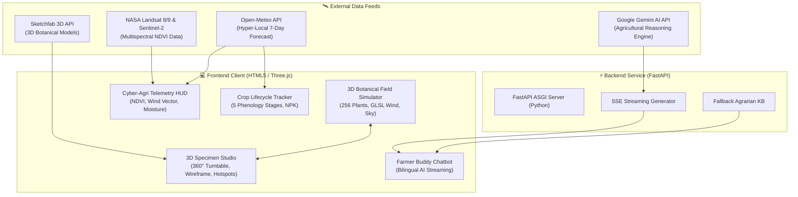

<div align="center">

# 🌾 AgriVision / Field Shift
### AI-Powered Climate-Smart Agriculture & Botanical 3D Digital Twin
**NASA Space Apps Challenge Global Nominee**

[](https://threejs.org/)
[](https://www.khronos.org/webgl/)
[](https://fastapi.tiangolo.com/)
[](https://ai.google.dev/)
[](https://earthdata.nasa.gov/)
[](https://open-meteo.com/)
[](https://opensource.org/licenses/MIT)

<br/>

[🌐 **Explore Live Demo**](https://g-sadi.github.io/Nasa-Space-Apps-Challenge-website/) • [🎥 **Watch Video Presentation**](#) • [📖 **Project Documentation**](#system-architecture)

</div>

---

## 🌟 Executive Overview

**AgriVision (Field Shift)** is an advanced agricultural intelligence platform and living botanical digital twin developed for the **NASA Space Apps Challenge**. By synthesizing satellite observations (NASA Landsat 8/9, Sentinel-2), hyper-local predictive weather telemetry, and high-performance WebGL 3D simulation, AgriVision helps farmers, researchers, and agronomists anticipate climate stress, optimize crop rotation, and boost crop yield resilience.

---

## 🚀 Key Innovations & Modules

### 1. 🌾 Botanical Procedural 3D Living Field Simulator
- **Dense GPU Instancing**: Simulates **256 distinct plant clusters** (16×16 furrow grid) in real-time at 60 FPS via `THREE.InstancedMesh`.
- **Strict Ban on Cartoon Primitives**: Authentic botanical geometry engine featuring:
  - Tapered curved ribbon blades with longitudinal center creases.
  - Catmull-Rom spline rachis with drooping golden grain panicles.
  - Alternating compound leaflets, serrated margins, and botanical fruit calyxes.
- **Physical Materials & SSS**: `THREE.MeshPhysicalMaterial` with subsurface transmission, realistic IOR, clearcoat, and procedural vein bump maps.
- **Dynamic Terrain & Water Layer**: Procedural earthen bunds (মাটির আল), furrow ridges, and reflective wetland water for paddy & jute.
- **GPU Wind Shader (`onBeforeCompile`)**: Sine/cosine turbulence with anchored root bases that sways individual leaves naturally with wind vectors.
- **Day/Night Atmospheric Sky**: Three.js atmospheric Rayleigh scattering Sky shader with dynamic sun elevation slider and procedural GLSL drifting clouds.

---

### 2. 🔬 Sketchfab-Grade 3D Crop Specimen Studio & Inspector
- **360° Turntable Pedestal**: An isolated studio mode featuring a brushed dark metallic turntable with glowing emerald CAD rings (`#43ef8c`) and degree markers.
- **Multi-Mode Shading Inspector**:
  - 🌟 **PBR Lit**: Full physical lighting with subsurface scattering, transmission, and gloss highlights.
  - 🕸️ **Wireframe Mode**: Topological wireframe mesh inspector for polycount and geometric curvature evaluation.
  - 🌿 **Vein X-Ray**: Amplified bump venation map highlighting vascular transport bundles.
  - 🏺 **Clay Studio**: Clean monochrome clay render for silhouette and morphological scrutiny.
- **Interactive 3D Hotspot Annotations**: Numbered pins hovering on real-time 3D plant anatomy (Panicle, Blade, Stalk, Root Crown) that track camera motion and display interactive agricultural advice upon click.
- **15-Crop 3D Specimen Collection**: Integrated cards with Sketchfab-style 3D previews, polygon count, scientific classification, and direct links to Sketchfab's 3D botanical repository:
  1. 🌾 **Rice** (*Oryza sativa*)
  2. 🌾 **Wheat** (*Triticum aestivum*)
  3. 🌽 **Maize** (*Zea mays*)
  4. 🌿 **Jute** (*Corchorus olitorius*)
  5. 🥔 **Potato** (*Solanum tuberosum*)
  6. 🌼 **Mustard** (*Brassica nigra*)
  7. 🍅 **Tomato** (*Solanum lycopersicum*)
  8. 🍆 **Eggplant** (*Solanum melongena*)
  9. 🌶️ **Chili** (*Capsicum annuum*)
  10. 🌱 **Lentil** (*Lens culinaris*)
  11. 🥒 **Cucumber** (*Cucumis sativus*)
  12. 🥦 **Cauliflower** (*Brassica oleracea*)
  13. 🧅 **Onion** (*Allium cepa*)
  14. 🥕 **Carrot** (*Daucus carota*)
  15. 🍈 **Papaya** (*Carica papaya*)

---

### 3. 🤖 Farmer Buddy AI Assistant (কৃষক বন্ধু)
- **FastAPI + Google Gemini API**: Ultra-low-latency Server-Sent Events (SSE) streaming responses tailored for agrarian advisory.
- **Bilingual Dialogue Engine**: Seamless bilingual capabilities supporting both **Bengali (বাংলা)** and **English (EN)** with localized dialect sensitivity.
- **Offline Resilient Knowledge Base**: Instant intelligent fallback advice when offline or working in low-connectivity rural farm regions.
- **Floating Glassmorphic Interface**: Responsive floating assistant widget with voice input/TTS support and quick suggestion pills.

---

### 4. 🌦️ Hyper-Local Weather & Krishi Alerts
- Real-time 7-day meteorological forecast powered by Open-Meteo.
- Automatic 3-hour `localStorage` caching with stale-while-revalidate strategy.
- Automated weather severity advisory: precipitation warning, humidity alerts, and heat-index warnings.

---

### 5. 📊 Interactive Crop Lifecycle & Phenology Tracker
- Comprehensive developmental tracking across 5 phenological stages for each crop.
- Precise N-P-K (Nitrogen, Phosphorus, Potassium) basal and top-dressing dose calculations.
- Integrated pest and disease alert matrix with organic and chemical management protocols.

---

## 🏗️ System Architecture



---

## 🛠️ Tech Stack & Libraries

| Domain | Technology / Library | Purpose |
| :--- | :--- | :--- |
| **3D Rendering** | Three.js (r165), WebGL 2.0 | Procedural botanical mesh generation, lighting & shaders |
| **Post-Processing** | ACESFilmic Tone Mapping, PCFSoftShadows | Cinematic agricultural color science |
| **Shaders** | Custom GLSL Vertex & Fragment Shaders | GPU wind turbulence swaying, procedural drifting clouds |
| **Backend** | Python 3.10+, FastAPI, Uvicorn | Streaming API server for AI agent |
| **AI / LLM** | Google Gemini 1.5 / 2.0 API via `google-genai` | Intelligent agricultural reasoning & dialogue |
| **Weather** | Open-Meteo REST API | Hyper-local temperature, precipitation, and wind forecast |
| **Styling** | Vanilla CSS3, Glassmorphism, CSS Grid | Deep Forest Green (`#06150f`) & Neon Emerald (`#43ef8c`) |
| **Internationalization** | `i18n.js` Custom Event Dispatcher | Real-time English / বাংলা language toggle |

---

## 📦 Getting Started & Local Development

### 1. Clone the Repository
```bash
git clone https://github.com/G-Sadi/Nasa-Space-Apps-Challenge-website.git
cd Nasa-Space-Apps-Challenge-website
```

### 2. Run Frontend Web Application
No build step or npm installation is required for the frontend! You can serve the root directory with any HTTP server:
```bash
# Using Python built-in HTTP server:
python -m http.server 8000
```
Open your browser and navigate to:
```
http://localhost:8000
```

### 3. Run Farmer Buddy AI Assistant Backend (Optional)
```bash
cd backend
python -m venv venv
# On Windows:
.\venv\Scripts\activate
# On Linux/macOS:
source venv/bin/activate

pip install -r requirements.txt
export GEMINI_API_KEY="your-gemini-api-key"
uvicorn main:app --reload --port 8000
```

---

## 🎯 NASA Space Apps Challenge Alignment

- **Earth Observation Integration**: Uses NASA Landsat and Sentinel-2 multispectral vegetation index data to simulate localized soil and vegetation dynamics.
- **Climate Adaptation**: Empowers smallholder farmers facing climate shifts with predictive resilience recommendations and resource-efficient farming protocols.
- **Open Science & Open Access**: 100% open-source, mobile-friendly, and accessible in local languages to maximize real-world impact.

---

## 📄 License
This project is licensed under the **MIT License** — feel free to use, enhance, and adapt for non-commercial and humanitarian agricultural missions.

---

<div align="center">
Made with 💚 for the <b>NASA Space Apps Challenge</b>
</div>
