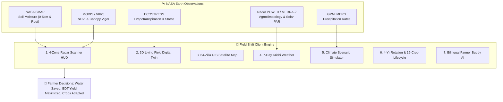

<div align="center">

# 🌾 Field Shift
### Smart Farm Intelligence & 3D Agricultural Digital Twin
**Official Project for the NASA International Space Apps Challenge 2026**  
*Engineered with 💚 by **Team ASL_Spectra** (Bangladesh)*

<br/>

[](https://www.spaceappschallenge.org/)
[](https://g-sadi.github.io/Nasa-Space-Apps-Challenge-website/)
[](https://power.larc.nasa.gov/)
[](https://threejs.org/)
[](https://leafletjs.com/)
[-8b5cf6?style=for-the-badge&logo=google-gemini&logoColor=white)](https://ai.google.dev/)
[](https://www.youtube.com/@team-spectra_2026)

<br/>

### 🌐 Showcase Links & Video Presentations
[🚀 **Launch Live Web Application**](https://g-sadi.github.io/Nasa-Space-Apps-Challenge-website/) • [🎥 **Watch 240s Official Pitch Video**](https://www.youtube.com/watch?v=fh6zsdTMMQ8) • [⚡ **Watch 30s Feature Shorts**](https://www.youtube.com/shorts/jdqRpXBAS44) • [📺 **Team YouTube Channel**](https://www.youtube.com/@team-spectra_2026)

</div>

---

## 📖 Executive Summary & Problem Statement

Smallholder farmers cultivate over 70% of South Asia's arable land, yet they operate on the frontlines of catastrophic climatic volatility. Across Bangladesh's **30 Agro-Ecological Zones (AEZ)**:
- **Unpredictable Monsoon Shifts:** Irregular rainfall patterns disrupt traditional Aus, Aman, and Boro rice planting calendars.
- **Micro-Climate Extremes:** The northwestern Barind Tract experiences severe subsoil moisture depletion, while southeastern coastal plains face salinization and flash floods.
- **The Information Chasm:** While NASA satellites orbit 400–700 km above Earth collecting multi-spectral data, smallholder farmers have zero access to actionable, field-level guidance in their native language.

### Our Solution: "Field Shift"
**Field Shift** transforms complex NASA Earth Observation telemetry (**SMAP, MODIS, ECOSTRESS, GPM IMERG, and MERRA-2**) into an intuitive, zero-latency digital dashboard. With an interactive **4-Zone Satellite Radar HUD**, a photorealistic **3D Agricultural Digital Twin**, an all-district **64-Zilla GIS Satellite Map**, a **Climate Scenario Simulator**, and a bilingual **Farmer Buddy AI**, Field Shift empowers farmers to adapt their land, optimize irrigation, and select climate-resilient crops.

---

## 🏛️ System Architecture: 7 Core Interactive Modules



---

### Module 1: 4-Zone NASA SMAP Live Satellite Radar HUD
- **Real-Time Telemetry Scanner:** Sweeping radar laser across 4 distinct field zones (Zone A: North Plot, Zone B: Canal Side, Zone C: Lowland Basin, Zone D: High Terrace).
- **Zonal Crop Intelligence:** Live telemetry displaying NASA SMAP soil moisture (`58% Optimal`), MODIS NDVI (`0.68 - 0.74`), and actionable irrigation recommendations (`"No Irrigation Needed"`, `"Conserve Water"`, `"Drain Excess"`).
- **Instant Telemetry Pulse:** Visual ripple telemetry animations indicating live data ingestion.

### Module 2: 3D Agricultural Digital Twin Simulation (Three.js & WebGL)
- **Photorealistic PBR Living Field:** Realistic terrain strata (topsoil, root layer, subsoil) with dynamic wind simulation, solar angle, and particle effects.
- **Cinematic Multi-Angle Camera Modes:**
  - 🛸 *Drone Top View* (Orthographic plot inspection)
  - 🌾 *Crop Close-Up* (Leaf transpiration, stem vigor, and pest inspection)
  - 🧪 *Root & Subsoil Strata View* (NPK absorption & moisture penetration depth)
- **Time-of-Day Lighting Engine:** Seamlessly toggle between **Dawn**, **Noon Sun**, and **Night Sky** with realistic celestial shadows and atmospheric scattering.
- **Smart Solar IoT Pump Sync:** Virtual pump visualization responding to zonal soil moisture thresholds.

### Module 3: All 64 Bangladesh Zillas + Custom Plot GIS Satellite Map (Leaflet)
- **High-Resolution Satellite Layer:** Integrated with **Esri World Imagery** satellite tiles (`24.7471° N, 90.4203° E` default center).
- **0ms Instant Fuzzy Multi-Engine Search:**
  - Fuzzy-matches all **64 districts across 8 divisions** with alternate transliterations (*Chattogram/Chittagong*, *Cumilla/Comilla*, *Jashore/Jessore*, *Bogura/Bogra*, *Barishal/Barisal*).
  - Sub-area & Upazila resolution (e.g., *Bakshibazar Dhaka*, *Trishal Mymensingh*, *Srimangal Tea Belt*, *Gadkhali Flower Zone*, *Bhimruli Floating Market*).
  - 8-Division Quick Selector dropdown right inside the map HUD.
- **Interactive Land Selection:** Click anywhere on Bangladesh to instantly calculate distance to the nearest river (e.g., *Old Brahmaputra, Buriganga, Gumti, Surma*), nearest pond/canal, soil condition, and recommended crops.

### Module 4: 7-Day Hyper-Local Krishi Weather Forecast
- **GPS-Synced Predictive Telemetry:** Hyper-local 7-day temperature, precipitation probability, humidity, and wind speed forecasts.
- **Automated Agronomic Alerts:** Proactive warnings for sudden monsoon downpours, pest infection humidity thresholds, and heat stress windows.

### Module 5: Climate Scenario Simulator & Dual-Axis Yield Model
- **Dynamic Dual-Line Chart:** Integrated Chart.js canvas rendering **Rainfall (mm)** alongside **Water Availability (%)** across all 12 farming months.
- **Interactive Stress-Testing Sliders:**
  - 🌧️ *Rainfall Shift* (-50% drought to +50% flood)
  - 🌡️ *Temperature Anomaly* (-3°C to +5°C warming)
  - 💧 *Water Resource Capacity* (Irrigation canal level)
- **Live Economic Forecasting:** Automatically switches recommended crops based on climate thresholds (e.g., Rice $\rightarrow$ Mustard/Lentils $\rightarrow$ Maize) and projects estimated BDT profit per acre.

### Module 6: 4-Year Multi-Season Field Rotation Planner & 15-Crop Lifecycle Tracker
- **4-Year Soil Health Cycle (2026–2029):** Optimizes Kharif-1, Kharif-2, and Rabi seasons to restore nitrogen, prevent pest cycles, and maintain organic carbon.
- **15 Native Crops Tracked:** *Rice (আমন, বোরো, আউশ), Wheat, Jute, Potato, Tomato, Mustard, Lentils, Maize, Eggplant, Onion, Chili, Carrot, Cauliflower, Cucumber, Papaya*.
- **5-Stage Botanical Lifecycle:** Interactive progress tracker from Germination to Harvesting with exact NPK fertilizer ratios, water requirements, and temperature brackets.

### Module 7: Bilingual Farmer Buddy AI (কৃষি বন্ধু)
- **Voice & Text Multimodal Agronomist:** Native English and fluent Bangla interface.
- **Instant Agronomic Guidance:** Answering questions on fertilizer dosage, pest mitigation, weather adaptation, and government crop subsidies.
- **Tier-3 Architecture:** Instant offline agronomy knowledge base fallback + live Gemini streaming proxy.

---

## 🛰️ NASA Earth Observation Datasets Used

| NASA Mission / Dataset | Sensor / Platform | Primary Scientific Telemetry | Application in Field Shift |
|:---|:---|:---|:---|
| **NASA SMAP** | L-band Radar/Radiometer | Surface & Root-Zone Soil Moisture ($m^3/m^3$) | Powers 4-Zone Radar HUD & Irrigation Threshold Advisories |
| **MODIS / VIIRS** | Terra & Aqua Spectroradiometer | NDVI, EVI & Leaf Area Index (LAI) | Evaluates crop canopy health, vigor, and vegetative biomass |
| **ECOSTRESS** | Spaceborne Thermal Radiometer (ISS) | Evapotranspiration (ET) & Plant Water Stress | Identifies heat stress & micro-scale irrigation urgency |
| **GPM IMERG** | Dual-frequency Precipitation Radar | Multi-satellite Global Precipitation Rates (mm/hr) | Calibrates Scenario Simulator and 7-Day Rainfall models |
| **NASA POWER / MERRA-2** | Modern-Era Retrospective Analysis | Solar PAR, Surface Temperature, Relative Humidity | Drives 64-Zilla agroclimatology profiles & yield projections |

---

## 🛠️ Complete Technology Stack

```text
Frontend:         HTML5, Modern CSS3 (Glassmorphism & Flexbox/Grid), Vanilla ES6+ JavaScript
3D Visualization: Three.js (r160), WebGL Shader Materials, Procedural PBR Botany
GIS Mapping:      Leaflet.js (v1.9.4), Esri World Imagery Satellite Tiles, Photon Geocoder
Data Science:     Chart.js (v4.4), Custom Agro-Ecological Zone (AEZ) Matrix (64 Zillas)
AI Engine:        Google Gemini Multimodal API + Native Offline Agronomy Rule Engine
Cloud / Hosting:  GitHub Pages, GitHub Actions CI/CD Pipeline (Automated Deployments)
Design / UX:      Custom SVG Agri-Space Emblem, Space-Grade Dark Glass UI (#04160b Emerald)
```

---

## 🚀 Quick Start & Local Setup

### 1. Clone the Repository
```bash
git clone https://github.com/G-Sadi/Nasa-Space-Apps-Challenge-website.git
cd Nasa-Space-Apps-Challenge-website
```

### 2. Run the Web Application Locally
You can run Field Shift using any static web server:

```bash
# Option A: Using Python built-in server (Zero installation required)
python -m http.server 8080

# Option B: Using Node.js npx serve
npx serve -l 8080 .
```

Open your browser and navigate to:
```text
http://localhost:8080
```

### 3. (Optional) Run the Local Python Backend
To enable the optional local AI backend proxy:
```bash
cd backend
python -m venv venv
venv\Scripts\activate       # On Windows
source venv/bin/activate    # On Linux/macOS
pip install -r requirements.txt
python main.py
```

---

## 👥 Team ASL_Spectra (Credits & Roles)

*Developed for the **2026 NASA International Space Apps Challenge** by **Team ASL_Spectra** from Bangladesh:*

- **Monjirul Islam Sadi (G-Sadi)** — *Team Lead, Principal Full-Stack Architect & 3D WebGL Engineer*
- **Team ASL_Spectra Agronomy & GIS Researchers** — *Agricultural Data Modeling, AEZ Soil Mapping & NASA EO Telemetry Calibration*

<br/>

<div align="center">

### 🌾 Transforming Space Science into Earth Bounty
*Built with passion for farmers around the world.*

[](https://github.com/G-Sadi/Nasa-Space-Apps-Challenge-website)
[](https://www.youtube.com/watch?v=fh6zsdTMMQ8)

</div>
